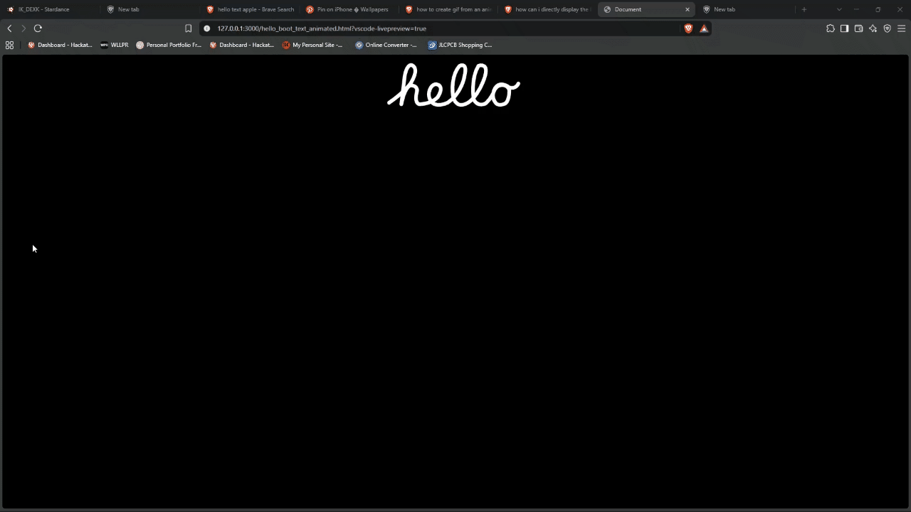

# APPLE Style Hello TEXT animated HTML UI component

I made the iconic hello welcoming screen of apple devices in HTMl, CSS and JS.<br>
I made the whole thing from scratch.

### Here is a demo GIF>>

                     

## Process

* I first created a vector in Adobe illustrator using the pen tool then exported it as a svg.<br>
* Then I took that svg and edited it in HTML, CSS and JS.

## Features
* customizable 
* smooth 

## How to Embed in your page

1. Download the files 
2. Copy the svg code from the downloaded html file.
3. Link the script and css.

## Coustomizing

### For changing the color

1. Go to the .css file.
2. Change stroke to your wanted color.
```css 
#hello_path{
    fill: none;
    stroke: #ffffff;
    stroke-width:12;
    stroke-linecap:round;
    stroke-linejoin: round;
} 
```

### Increasing or decreasing animation speed 

1. Go to the .js file.
2. Change the 3.5 to whatever the time you want your animation to take in seconds.

```javascript 

 path.style.transition = 'stroke-dashoffset 3.5s ease-in-out'
```
